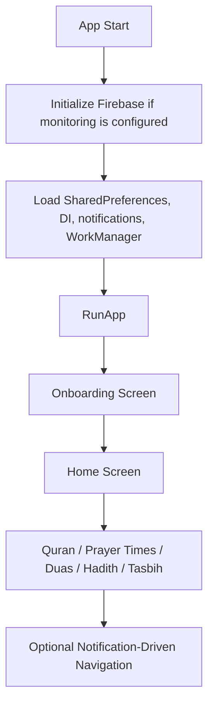

# 🚀 Sakina App

A modern Islamic Flutter application for Quran reading, prayer times, adhkar/duas, hadith, and daily worship tools.

## 📱 Screenshots

| Home | Quran | Adhkar | Hadith |
|------|-------|--------|--------|
|  |  |  |  |

## 🌟 Features

- 🔹 **Quran Reading** - Browse surahs and read verses with an Arabic-first experience.
- 🔹 **Prayer Times** - Calculated on the device with `adhan_dart` (no network), for a bundled city, typed coordinates or the device location.
- 🔹 **Duas & Adhkar** - Dedicated sections for daily azkar and supplications.
- 🔹 **Hadith Section** - Read hadith collections from local assets.
- 🔹 **Tasbih Counter** - Digital tasbih with simple interaction flow.
- 🔹 **Khatma Tracking** - Track recitation progress and reminders.
- 🔹 **Notifications** - Local prayer alerts (sound, silent, or a chosen adhan recording on Android), adhkar and reading reminders, rescheduled after reboot and timezone changes.
- 🔹 **Dark/Light Theme** - Theme switching with persisted settings.

## 🛠️ Technologies & Packages

### 🔧 Core Technologies

- Flutter
- Dart
- Firebase (Core + optional Crashlytics)
- Material 3

### 📦 Key Packages

- State Management: Provider
- Networking: http
- Routing: go_router
- Serialization: json_annotation + json_serializable
- Local Storage: shared_preferences
- Notifications: flutter_local_notifications + workmanager + timezone
- Utilities: url_launcher

## 🏗️ Architecture

The project follows a scalable and maintainable architecture:

```text
lib/
├── core/
│   ├── constants/         # App-wide constants
│   ├── errors/            # Error models and handlers
│   ├── navigation/        # Router and notification routing
│   ├── providers/         # Global providers (settings, notifications)
│   ├── services/          # Notification and background services
│   ├── theme/             # Colors, typography, themes
│   ├── utils/             # Shared utility functions
│   └── widgets/           # Reusable widgets
│
└── features/
      ├── onboarding/
      │   ├── data/
      │   ├── domain/
      │   └── presentation/
      ├── quran/
      │   ├── data/
      │   ├── domain/
      │   └── presentation/
      ├── prayers/
      │   ├── data/
      │   ├── domain/
      │   └── presentation/
      ├── duas/
      ├── hadeath/
      ├── khatma/
      └── settings/
```

## 🔄 App Flow



## 🎨 UI/UX Design

### 🎨 Colours and typography

Colours, designs (light, dark and dark-only themes) and type scales are
defined in `lib/core/theme/` and documented in
[SAKINA_DESIGN_SYSTEM.md](SAKINA_DESIGN_SYSTEM.md). UI text uses Cairo; the
Quran uses Amiri Quran.

### 🧭 Navigation

- GoRouter-based named routes
- Home hub with feature navigation cards
- In-app routing for notification taps (the app declares no external deep links)

## 🚀 Getting Started

### 📌 Prerequisites

- Flutter SDK `>=3.44.0` (CI pins `3.47.9` on the stable channel; see `.github/workflows/flutter-quality.yml`)
- Dart SDK bundled with that Flutter version (`pubspec.lock` requires `>=3.13.0`)
- Android Studio or VS Code

### ⚙️ Installation

```bash
git clone https://github.com/Khaled-shahien/quran_app.git
cd quran_app
flutter pub get
copy .env.example .env
flutter run --dart-define-from-file=.env
```

### 🔑 API keys

- **Where the key lives:** `YOUTUBE_API_KEY` goes in your local `.env`, which is ignored by git. It is only needed by the video screen. `.env.example` is tracked and must keep an empty value.
- **How to run:** `flutter run --dart-define-from-file=.env`
- **Enable the pre-commit scan once per clone:** `git config core.hooksPath .githooks`
- **Never write a key** in docs, plans, issues, commit messages, or chat logs.

CI runs `dart run scripts/check_secrets.dart` on all tracked files, and the hook runs it with `--staged`. Neither scans git history. Any key compiled into the app can be extracted from the APK, so restrict it to the YouTube Data API and set a daily quota.

### 🏭 Environment profiles

The app now supports explicit startup profiles via build-time configuration:

```bash
flutter run --dart-define=APP_ENV=development
flutter run --dart-define=APP_ENV=staging
flutter run --dart-define=APP_ENV=production
```

Production builds may also enable Firebase monitoring with:

```bash
flutter run --dart-define=APP_ENV=production --dart-define=ENABLE_FIREBASE_MONITORING=true
```

This keeps local defaults separate from release defaults and makes environment
behavior reviewable before shipping.

## 📁 Project Structure

### 🔹 Core Layer

Contains shared logic:

- Utilities
- Constants
- Themes
- Shared widgets
- Services (notifications and background tasks)

### 🔹 Feature Layer

Each feature is isolated and modular:

- Data Layer -> API calls, local data sources, repositories
- Domain Layer -> Entities, repository contracts, business logic
- Presentation Layer -> Screens, providers, widgets

## 🔐 Backend / API / Firebase Integration

- 🔑 Authentication -> Not enabled yet; the app is intentionally local-first and non-authenticated
- ☁️ Database -> Local assets + SharedPreferences cache (Firestore not used currently)
- 🌐 APIs -> Quran recitation (api.quran.com), article RSS feeds and YouTube search (optional key); prayer times and the Quran text are offline
- 🔔 Messaging -> Local notification scheduling; remote push is not supported

## 📘 Product and Release Documentation

- [docs/audit/EXECUTIVE_SUMMARY.md](docs/audit/EXECUTIVE_SUMMARY.md) - the current audit, findings and the implementation roadmap (source of truth for planned work).
- [docs/DEVELOPMENT_PLAN_AUDIT.md](docs/DEVELOPMENT_PLAN_AUDIT.md) - current evidence-based status of all 28 development-plan tasks.
- [docs/ARCHITECTURE_BOUNDARIES.md](docs/ARCHITECTURE_BOUNDARIES.md) - current ownership rules for providers, repositories, and shared services.
- [docs/LIFECYCLE_ASSUMPTIONS.md](docs/LIFECYCLE_ASSUMPTIONS.md) - expected behavior across resume, restart, migration, and background scheduling.
- [docs/APP_SCOPE_AND_AUTH.md](docs/APP_SCOPE_AND_AUTH.md) - defines the app’s explicit local-only product scope and authentication policy.
- [docs/RELEASE_VALIDATION_MATRIX.md](docs/RELEASE_VALIDATION_MATRIX.md) - documents the required validation gates for public releases.
- [docs/PRODUCTION_DIAGNOSTICS_POLICY.md](docs/PRODUCTION_DIAGNOSTICS_POLICY.md) - outlines the safe operational monitoring policy.

## 📱 Responsive Design

The app supports multiple platforms:

- ✅ Mobile
- ✅ Tablet (layout-adaptive widgets)
- ✅ Web (Flutter web target available)
- ✅ Desktop (Windows, macOS, Linux folders included)

## 🧪 Testing

Run tests using:

```bash
flutter test
```

Verify formatting and run static analysis:

```bash
dart format --output=none --set-exit-if-changed lib test integration_test
flutter analyze
```

### Test Types

- Unit Tests
- Widget Tests
- Integration Tests (`integration_test/`; run on a device, and in CI on an Android emulator)

## 🤝 Contributing

To contribute:

1. Fork the repository.
2. Create a new branch.
3. Make your changes.
4. Commit your work.
5. Push to GitHub.
6. Open a Pull Request.

## 📄 License

No license file is currently included. All rights remain with the repository
owner unless a license is added in a future change.

## 🙏 Acknowledgements

- Flutter
- Dart
- Material Design
- Firebase
- All external packages used in pubspec

## 📞 Support (Optional)

- GitHub Issues
- Discussions
- Wiki

## 📚 Predefined Project Profile (For AI Usage)

### 🕌 Islamic App

- Features:
   - Quran
   - Hadith
   - Prayer Times
   - Tasbih Counter
   - Dark/Light Mode
   - Arabic-only localization
- Technologies:
   - Flutter
   - Provider
   - http
   - Optional Firebase monitoring
- Architecture:
   - Feature-first + Clean Architecture
